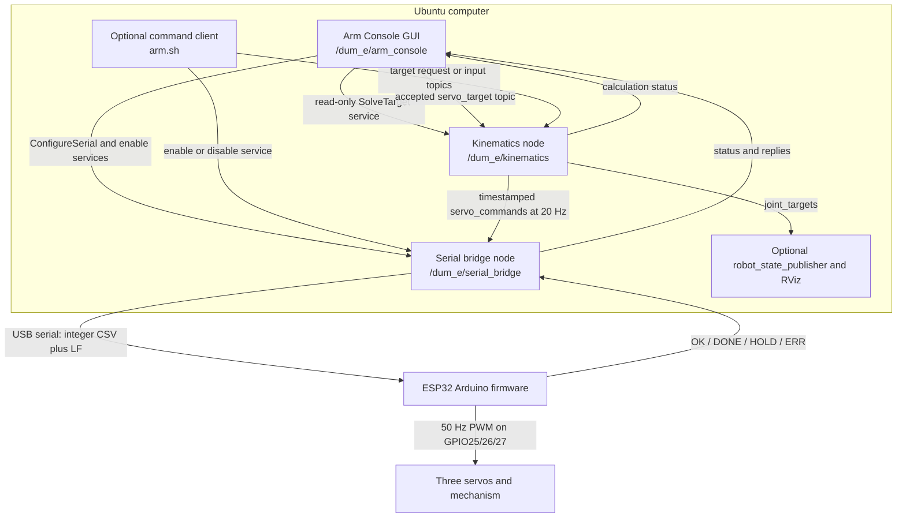
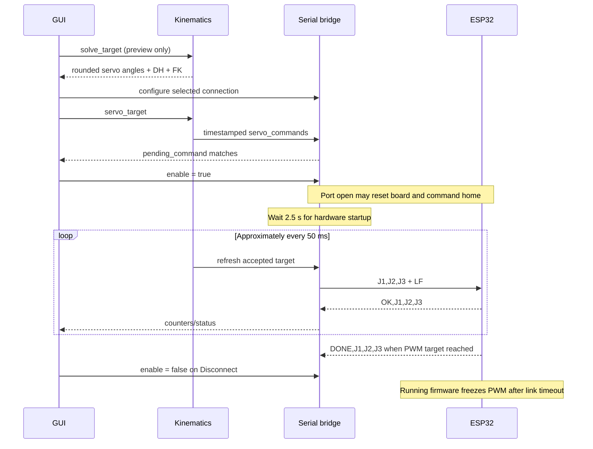
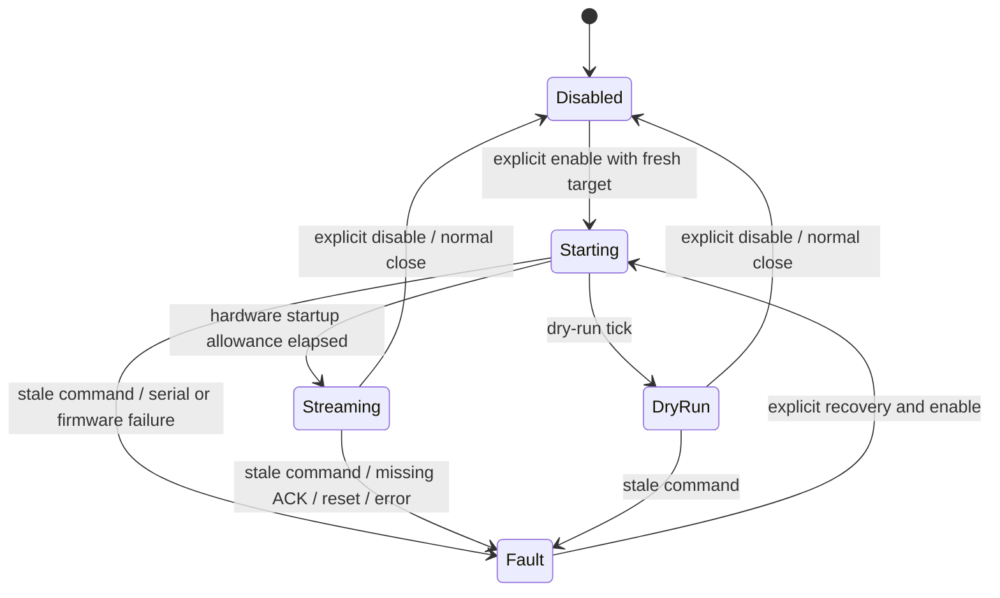

# Dum-E Robotic Arm v0: architecture, operation, and testing

**Project:** `/home/hrishikesh/Desktop/Dum-E Robotic Arm v0`  
**Platform:** Ubuntu 24.04, ROS 2 Jazzy, Python 3.12, classic ESP32/WROOM  
**Guide checked against the implementation on:** 3 November 2026

This is the detailed manual for the ROS 2 version of your three-joint arm. It explains what runs where, how a GUI action becomes servo output, the important controls, every project control/configuration file, and a staged procedure for testing the real mechanism.

The ROS 2 port keeps the existing calibration and ESP32 serial protocol. The original Windows controller and firmware sources remain in the repository. The GUI you should use for ROS 2 is started with **`gui.sh`**, rather than the old `Code/arm_interface/app.py`.

## Contents

1. [What has been built](#1-what-has-been-built)
2. [ROS 2 concepts used here](#2-ros-2-concepts-used-here)
3. [Processes and architecture](#3-processes-and-architecture)
4. [Following a command through the system](#4-following-a-command-through-the-system)
5. [Coordinates, units, calibration, FK, and IK](#5-coordinates-units-calibration-fk-and-ik)
6. [Topics, messages, services, and parameters](#6-topics-messages-services-and-parameters)
7. [Serial protocol and ESP32 behavior](#7-serial-protocol-and-esp32-behavior)
8. [The GUI: every important control](#8-the-gui-every-important-control)
9. [Files and directories: what each one does](#9-files-and-directories-what-each-one-does)
10. [Build and launch procedures](#10-build-and-launch-procedures)
11. [Step-by-step test procedure](#11-step-by-step-test-procedure)
12. [Automated tests and what they prove](#12-automated-tests-and-what-they-prove)
13. [Inspecting ROS and recording a test](#13-inspecting-ros-and-recording-a-test)
14. [Failures, stopping, and recovery](#14-failures-stopping-and-recovery)
15. [Troubleshooting](#15-troubleshooting)
16. [Changing the system later](#16-changing-the-system-later)
17. [Daily operating checklist](#17-daily-operating-checklist)

## 1. What has been built

The normal control system has **two control nodes**:

- **Kinematics:** accepts targets, calculates FK/IK, checks limits, applies calibration, rounds to servo degrees, and repeatedly publishes the last accepted target.
- **Serial bridge:** receives those final servo commands, sends them to the ESP32, reads replies, and disables the connection on specified faults.

The GUI is a **third ROS client node** when you use the graphical interface. It provides the original Jog/FK/IK and Loop pages. It asks the kinematics node to calculate; it asks the serial node to connect. It does not independently run the arm's FK/IK solver or open the serial device.

The ESP32 remains an ordinary Arduino firmware receiver. It is **not running ROS 2 or micro-ROS**. It parses simple serial frames and generates servo PWM. No firmware reflash was needed for this migration.

| Capability | Present behavior |
|---|---|
| Mechanism | Three revolute joints: base, shoulder, elbow |
| Commands | Servo degrees, mathematical DH radians, or Cartesian XYZ |
| GUI units | Servo/DH display in degrees; XYZ in millimetres |
| ROS Cartesian units | Metres |
| ROS mathematical joint units | Radians |
| Normal host command rate | Nominal 20 Hz |
| ESP32 servo PWM | 50 Hz |
| Normal coordinated motion | Longest-moving joint limited to nominal 50 degrees/s |
| Feedback | Serial acceptance and commanded PWM completion |
| Physical encoders | None in this implementation |
| Planning | Position IK and coordinated joint motion; no collision planning |
| Startup | ROS starts disconnected; ESP32 itself commands home on boot/reset |

**The most important distinction:** an accepted target, a successful serial write, an ESP32 ACK, and actual physical arm arrival are different events. This implementation observes the first three and the firmware's PWM completion. Physical shaft positions must be checked by observation or measurement.

The current board passed real home-only communication tests through both ROS nodes and through the GUI. Broader physical movements, calibration accuracy, loaded operation, and clearance were not established by those tests. See [VALIDATION.md](VALIDATION.md) for recorded results.

## 2. ROS 2 concepts used here

### 2.1 ROS 2 is the communication and software framework

Ubuntu is the operating system. ROS 2 supplies libraries, message definitions, communication, discovery, launch tools, and inspection commands. The arm's particular geometry and control behavior are implemented by this project's code.

| Term | Meaning | Example in this project |
|---|---|---|
| Node | A participant with a logical responsibility in the ROS graph | `kinematics`, `serial_bridge`, `arm_console` |
| Process | A running operating-system program | Each of those nodes is launched in its own process here |
| Package | A named unit of ROS source, dependencies, and installed resources | `dum_e_control`, `dum_e_interfaces` |
| Workspace | Directory containing ROS packages and build products | `ros2_ws/` |
| Topic | A named publisher/subscriber data channel | `/dum_e/servo_commands` |
| Message | The typed data carried by a topic | `ServoCommand` contains a timestamp and three angles |
| Service | A named request/response operation | `solve_target` returns a calculation; `enable` changes connection state |
| Parameter | A node's configuration value | `publish_rate`, `command_timeout` |
| Namespace | A prefix grouping names | `/dum_e` |
| Launch file | Starts and configures several processes together | `arm.launch.py` |
| Executor/spinning | Processes ROS callbacks and responses | `rclpy.spin()` in the control nodes |
| QoS | Delivery/history settings for a ROS endpoint | Keep only one command; retain the latest status |
| DDS/RMW | Middleware layer used for discovery and message transport | Communication between the Python ROS nodes |
| URDF | Robot description containing links and joints | Generated schematic DH chain |
| TF | Relationships between named coordinate frames | `base_link` through the joints to `tool0` |
| RViz | Viewer of ROS data and robot descriptions | Displays the calculated target arm pose |

Official ROS explanations: [nodes](https://raw.githubusercontent.com/ros2/ros2_documentation/jazzy/source/Concepts/Basic/About-Nodes.rst), [topics](https://raw.githubusercontent.com/ros2/ros2_documentation/jazzy/source/Concepts/Basic/About-Topics.rst), and [services](https://raw.githubusercontent.com/ros2/ros2_documentation/jazzy/source/Concepts/Basic/About-Services.rst).

A node can publish, subscribe, serve requests, and call other services simultaneously. The serial bridge, for example, subscribes to commands, serves connection requests, and publishes status.

### 2.2 Why use topics for angles and services for calculations?

The angle stream continues at 20 Hz, so a topic suits it. There is no need to issue a new request/response operation for every heartbeat.

A GUI preview is a bounded calculation: send XYZ and a reference pose, get a solution or an error. That suits a service. Crucially, the preview service does **not** select a live movement target.

Enabling/disabling a connection is also a short request/response operation. The enable response means the bridge accepted that operation; it does not mean the physical arm has reached a position.

ROS actions are intended for operations with longer-running goal/progress/cancel semantics. This project does not implement a ROS trajectory action. Loop playback is its own client-side state machine driven by serial DONE replies.

### 2.3 Underlay, overlay, and building

- `/opt/ros/jazzy` is the installed ROS **underlay**.
- `ros2_ws/install` is this project's built **overlay**.
- Sourcing their setup files tells the shell where to find packages, libraries, generated interfaces, and executables.
- `colcon build` generates the custom interfaces and installs the Python package/resources into the overlay.

`build_ros2.sh` builds the workspace. The run helpers source the underlay and overlay for you. You must rebuild after changing source/configuration that is installed into the workspace. Editing `src/` does not automatically change the installed running program.

### 2.4 Discovery, domains, and the ROS daemon

ROS 2 nodes discover compatible endpoints through the middleware. You do not start a ROS 1 `roscore` for this project.

All related processes must use the same `ROS_DOMAIN_ID`; its default is 0 if unset. Another domain is useful for isolated software tests, but it is **not a hardware access lock or a security boundary**. Two domains could still try to use the same serial port. See the [official domain explanation](https://raw.githubusercontent.com/ros2/ros2_documentation/jazzy/source/Concepts/Intermediate/About-Domain-ID.rst).

The project helper defaults `ROS_AUTOMATIC_DISCOVERY_RANGE` to `LOCALHOST` unless you already set it. That keeps ordinary automatic discovery on this computer for the supported DDS setup. Remote computers need an explicit networking/discovery configuration. See [ROS discovery configuration](https://raw.githubusercontent.com/ros2/ros2_documentation/jazzy/source/Tutorials/Advanced/Improved-Dynamic-Discovery.rst).

The ROS CLI daemon caches graph information for command-line tools. It is not the arm controller and is not a ROS master. Stopping the CLI daemon does not stop the arm nodes.

### 2.5 The QoS choices here

Command/input endpoints use queue depth 1 with normal reliable, volatile delivery. A small queue favors the newest target rather than accumulating a long history of slider values. This is not a motion-trajectory queue or an absolute timing guarantee.

The two status topics use reliable, **transient-local**, depth-1 QoS. A newly opened compatible client can receive the latest status without waiting for a new edit. Kinematics status is published when its state changes; it is not itself a 20 Hz heartbeat. Serial status changes continuously while counters increase during streaming.

The actual stale-command checks are implemented by the bridge's timestamp and monotonic-time checks, not by a configured DDS lifespan policy. The application does not configure a DDS deadline/liveliness watchdog as a substitute for those checks. See [official QoS definitions](https://raw.githubusercontent.com/ros2/ros2_documentation/jazzy/source/Concepts/Intermediate/About-Quality-of-Service-Settings.rst).

## 3. Processes and architecture



If a Markdown viewer does not render Mermaid, the main control path is:

```text
GUI or CLI -> kinematics node -> serial bridge -> ESP32 -> servo PWM -> mechanism
                                      ^             |
                                      +-- replies --+
```

### 3.1 Node responsibilities and boundaries

| Component | Does | Does not do |
|---|---|---|
| GUI | Input editing, displays, remote previews, connection requests, in-memory pose lists, GUI loop sequencing | Open the serial port, measure shafts, independently solve the robot geometry |
| Kinematics node | Validate input; solve/verify FK and IK; apply servo mapping; round angles; maintain accepted target; publish it repeatedly | Drive GPIO, read encoders, plan a collision-free path |
| Serial bridge | Own serial device; send latest target; parse/match replies; check communication freshness; report/fault | Reapply joint offsets; calculate IK; know actual mechanical position |
| ESP32 firmware | Validate incoming integers; generate PWM; coordinate intermediate setpoints; report acceptance/completion; freeze PWM on running-firmware link timeout | Run ROS; verify physical shaft arrival; detect collisions |
| Servos | Respond to their PWM inputs using their internal electronics | Report measured joint position back through this implementation |
| RViz | Show the calculated target chain | Simulate dynamics or show actual intermediate shaft movement |

The split keeps geometry independent of the wire protocol. You can test calculations without opening hardware, and test the serial node against an emulated controller.

### 3.2 State ownership: several different meanings of “current”

| State | Owner | Meaning |
|---|---|---|
| GUI preview | GUI model adapter | The valid command currently shown in this GUI, including disconnected edits |
| Accepted target | Kinematics node | Last live target accepted through an input topic/home service |
| Pending command | Serial engine | Latest final command received from kinematics, whether connected or not |
| Last sent | Serial engine | Most recent complete frame written, or synthetic dry-run frame |
| Last ACK | Serial engine | Most recent matching validated OK reply |
| Last DONE | Serial engine | Most recent matching PWM-completion reply |
| Intermediate PWM | ESP32 | Current software pulse widths during its coordinated move |
| Physical position | Mechanism | Actual shaft/link position; not measured by this software |

A disconnected GUI preview may differ from the backend's last accepted target. Clicking Connect sends the **displayed GUI target**, then enables the selected connection.

Use **one movement-command client at a time**. Read-only status/graph monitors are fine in other terminals. The GUI is not a synchronized dashboard for arbitrary competing command publishers: it keeps its own preview state. If another CLI/GUI changes the target, an existing GUI preview can become stale. Reopen/reattach the GUI to initialize from the backend again rather than commanding from a stale preview.

## 4. Following a command through the system

### 4.1 Starting `gui.sh`

1. `gui.sh` calls the standard launcher with `gui:=true`.
2. The environment helper sources ROS Jazzy and this workspace and chooses local log directories.
3. The launch file starts kinematics, the serial bridge, and the GUI client.
4. Kinematics loads the robot model. Its initial display state is home, but `have_target` is false.
5. Serial starts disabled. It does not open the device.
6. The GUI waits for ROS services/status, asks for a read-only calculation, and builds the original controls.
7. The GUI shows either the backend's current accepted command or its initial home display.

Starting ROS or opening the GUI does not by itself send a movement command. Independently, powering/resetting the ESP32 runs its firmware startup-home behavior.

### 4.2 Moving a slider while disconnected

1. The GUI builds a candidate servo triple.
2. It calls `solve_target` with `mode: servo`.
3. The kinematics node validates raw limits, rounds, calculates DH/FK/conditioning, and returns a result.
4. The GUI updates its sliders, coordinate readouts, mapping calculations, and packet preview.
5. Its transport adapter stores that preview locally. It does not select a live target while the bridge is disabled.

This is how offline previews work while still delegating the calculations to ROS.

### 4.3 Pressing Connect & stream

1. The selected port determines hardware versus dry run. Selecting a real device can switch the bridge out of dry run even if you originally launched with `dry_run:=true`.
2. The GUI calls `serial_bridge/configure`. The bridge must be disabled for this request.
3. The GUI publishes the shown valid triple on `servo_target`.
4. Kinematics revalidates it atomically, stores it, and publishes `servo_commands` immediately and then at 20 Hz.
5. The GUI client waits until bridge status confirms the corresponding `pending_command`.
6. It calls the enable service. A fresh command is required.
7. For hardware, the serial bridge opens the chosen port and allows 2.5 seconds for board startup.
8. It starts sending the latest frame at nominal 20 Hz.
9. The ESP32 returns OK and, when appropriate, DONE. Status and reply topics update the GUI.

The pending-command wait avoids the startup discovery race where the calculator accepted a target before the serial node had received it.



### 4.4 Solving XYZ while connected

The GUI stages its three millimetre fields until you press Solve XYZ. It converts millimetres to metres for the service request. The backend solves using the GUI's current command as a branch reference, validates/rounds, and returns the achieved target.

Only a successful result replaces the GUI command. The transport adapter then publishes that resolved servo triple to kinematics, which validates it again before updating the live command stream. An invalid target keeps the last accepted command.

The direct ROS `target_position` topic also runs IK, but uses the backend's accepted target as its reference rather than a separately supplied GUI preview.

### 4.5 Loop execution

The GUI resolves every list item again before starting. Each item becomes an integer servo target. The loop player:

1. Requires an enabled, streaming link with recent ACKs.
2. Records the current completion count and sends one pose.
3. Waits for a newer matching DONE.
4. Starts a two-second hold after observing that completion.
5. Advances to the next pose, wrapping to the beginning after the last.

Manual editing is locked during playback. Stop loop stops advancing but keeps streaming the current target. ACK/DONE payloads contain angles rather than unique goal IDs; avoid simultaneous command clients.

The PC is not sending all intermediate points of a trajectory. The ESP32 generates intermediate PWM setpoints between accepted targets.

## 5. Coordinates, units, calibration, FK, and IK

### 5.1 Three coordinate representations

| Representation | Units | Example |
|---|---|---|
| Final servo command `J` | Integer degrees, each 0–180 | `[70,30,40]` |
| Mathematical DH angles `theta` | Degrees internally/in GUI; radians on ROS joint interfaces | `[20,30,-50]` degrees |
| End position relative to `base_link` | Millimetres internally/in GUI; metres on ROS interfaces | `[129.167339,46.970499,211.994814]` mm |

Servo 90 degrees is not necessarily mathematical joint zero. These are mounting-calibrated coordinates.

```text
J1 = 90 - theta1          theta1 = 90 - J1
J2 = theta2               theta2 = J2
J3 = 90 + theta3          theta3 = J3 - 90
```

J1 is reversed once by this mapping. The serial bridge and ESP32 receive final servo angles and must not reverse it again.

For ROS mathematical joints, convert degrees to radians with `radians = degrees * pi / 180`. For Cartesian ROS values, convert `metres = millimetres / 1000`.

### 5.2 The actual DH model

The transform convention is standard DH:

```text
A_i = Rz(theta_i) * Tz(d_i) * Tx(a_i) * Rx(alpha_i)
T03 = A1 * A2 * A3
```

| Joint | a (mm) | d (mm) | alpha (degrees) | Allowed DH angle from servo limits |
|---|---:|---:|---:|---|
| 1 | 10.35 | 45.74 | 90 | -90 to +90 degrees |
| 2 | 125.7 | 6.24 | -180 | 0 to +180 degrees |
| 3 | 105.0 | 6.20 | 0 | -90 to +90 degrees |

`a` is the translation along the new X axis, `d` along the preceding Z axis, and `alpha` the twist. The solver multiplies the transforms and calculates a position Jacobian.

For this particular twist pattern, let:

```text
delta = d2 - d3 = 0.04 mm
r = a1 + a2*cos(theta2) + a3*cos(theta2-theta3)
x = r*cos(theta1) + delta*sin(theta1)
y = r*sin(theta1) - delta*cos(theta1)
z = d1 + a2*sin(theta2) + a3*sin(theta2-theta3)
```

Trigonometry in that displayed equation uses degrees. Python's numerical functions use radians after conversion. The elbow expression contains `theta2-theta3` because of the -180-degree second twist.

The endpoint is the **origin of DH frame 3**, also represented by `tool0` in the generated description. There is no additional gripper/tool-tip transform. Measure the same point and use the same base origin when checking physical XYZ. Default display axis signs are `[1,1,1]`: X/Y/Z match the DH/world coordinates, with Z upward in the intended installation.

### 5.3 Reference values

These are model predictions, not physical measurements:

| Servo J1,J2,J3 (degrees) | DH angles (degrees) | X (mm) | Y (mm) | Z (mm) |
|---|---|---:|---:|---:|
| 90,45,180 — home | 0,45,90 | 173.479534 | -0.040000 | 60.377110 |
| 91,45,180 | -1,45,90 | 173.452415 | -3.067629 | 60.377110 |
| 90,46,180 | 0,46,90 | 173.199236 | -0.040000 | 63.221884 |
| 90,45,179 | 0,45,89 | 174.764001 | -0.040000 | 61.684193 |
| 70,30,40 — worked example | 20,30,-50 | 129.167339 | 46.970499 | 211.994814 |
| 90,0,90 — straight reference | 0,0,0 | 241.050000 | -0.040000 | 45.740000 |

The last two are useful numerical examples; they are not instructions to make a large first physical move. The straight reference is singular for position IK. Manual Jog/FK can represent singular poses, while IK rejects singular solutions.

### 5.4 What the IK solver checks

The analytical solver examines both signed-radius/base branches and elbow branches. It checks geometric reach, the small excluded axial region, servo-domain limits after mapping, and independent FK agreement. Of the valid nonsingular candidates, it chooses the one closest to the supplied/current servo reference.

The Jacobian's normalized minimum singular value detects singular/near-singular solutions. The default near-singular threshold is `0.001`. Candidates are then rounded to whole servo degrees and checked again for limits, singularity, and plausible Cartesian rounding displacement.

Consequences:

- A reachable mathematical point can still violate the calibrated servo limits.
- A geometrically reachable point can be rejected at a singularity.
- A continuous solution can become unsuitable after integer rounding.
- The same XYZ can produce different valid elbow branches from different references.
- Achieved XYZ is calculated from the rounded command and may differ from the requested XYZ.
- The GUI's ±500 mm slider span is an editor range, not a statement that the arm reaches every point in that cube.

### 5.5 What motion the model does not provide

Three joints can solve position here; they cannot independently assign arbitrary position plus arbitrary tool orientation. There is no obstacle model, collision checking, force control, encoder correction, Cartesian straight-line planner, MoveIt pipeline, ros2_control hardware interface, or Gazebo simulation in this implementation.

The servos' internal regulation is separate from the PC software. The PC does not receive their measured shaft positions. RViz and the FK readout follow targets rather than the arm's actual trajectory.

## 6. Topics, messages, services, and parameters

### 6.1 Topic reference

All names below use the default `/dum_e` namespace. Publishers/subscribers must agree on both name and type. These are application topics; ROS may also show parameter-event, logging, or visualization topics.

| Topic | Type | Producer -> consumer | Contents and use |
|---|---|---|---|
| `/dum_e/servo_target` | `std_msgs/msg/Float64MultiArray` | GUI/CLI/user -> kinematics | Three servo angles in degrees; raw finite/range validation happens before rounding |
| `/dum_e/joint_target` | `sensor_msgs/msg/JointState` | User -> kinematics | Exactly `joint_1`, `joint_2`, `joint_3`, each once, any order; three positions in DH radians |
| `/dum_e/target_position` | `geometry_msgs/msg/PointStamped` | User -> kinematics | XYZ metres; frame must be empty or match `base_frame` (default `base_link`) |
| `/dum_e/servo_commands` | `dum_e_interfaces/msg/ServoCommand` | Kinematics -> serial bridge | Fresh timestamp plus exactly three final integer servo degrees |
| `/dum_e/joint_targets` | `sensor_msgs/msg/JointState` | Kinematics -> viewers/monitors | DH target radians corresponding to the rounded servo command |
| `/dum_e/tool_target` | `geometry_msgs/msg/PointStamped` | Kinematics -> monitors | FK target XYZ in metres |
| `/dum_e/kinematics/status` | `std_msgs/msg/String` | Kinematics -> clients | JSON describing accepted state, counters, and errors |
| `/dum_e/serial_bridge/status` | `std_msgs/msg/String` | Bridge -> clients | JSON describing connection, pending command, counters, frames, and faults |
| `/dum_e/serial_bridge/tx` | `std_msgs/msg/String` | Bridge -> monitors | Exact complete transmitted ASCII frame; synthetic in dry run |
| `/dum_e/serial_bridge/rx` | `std_msgs/msg/String` | Bridge -> monitors/GUI | Received firmware line; synthetic replies in dry run |

The names `joint_target` and `joint_targets` are intentionally different: the singular name is an input, and the plural name is the calculated output. Neither output `joint_targets` nor `tool_target` is measured feedback.

For `PointStamped`, the current kinematics callback checks the frame name but does not look up TF or transform an arbitrary input frame. It does not use the incoming point timestamp as a target-expiration mechanism. The bridge separately checks timestamps on the generated servo command.

### 6.2 Custom `ServoCommand` message

Source: [ServoCommand.msg](ros2_ws/src/dum_e_interfaces/msg/ServoCommand.msg).

```text
builtin_interfaces/Time stamp
uint16[3] degrees
```

`uint16[3]` fixes the array length to three unsigned integer entries. The bridge additionally enforces 0–180 degrees; being representable as `uint16` alone is not enough. This field is explicitly a hardware-boundary degree representation, unlike ROS mathematical joint radians.

The bridge accepts a timestamp age between approximately -0.1 seconds and `command_timeout` (default +0.5 seconds). Older messages or messages too far in the future are ignored. It also checks how recently a valid command was received using a monotonic clock.

Kinematics repeatedly timestamps the accepted target even when no new GUI edit is made. Thus, an old but intentionally held target remains a fresh heartbeat while the calculator is alive. The watchdog detects loss of the calculator/stream, not user inactivity.

### 6.3 Service reference

| Service | Type | What the response means |
|---|---|---|
| `/dum_e/solve_target` | `dum_e_interfaces/srv/SolveTarget` | Validated read-only result or an error; does not update the live target |
| `/dum_e/home` | `std_srvs/srv/Trigger` | Selected `[90,45,180]` as the backend target; does not independently enable serial |
| `/dum_e/serial_bridge/configure` | `dum_e_interfaces/srv/ConfigureSerial` | Updated port/mode while disabled; device remains closed |
| `/dum_e/serial_bridge/enable` | `std_srvs/srv/SetBool` | `true`: accepted enable/open request; `false`: stopped streaming and closed the port |

**Home is a command, not a homing-sensor routine.** Calling `/home` while hardware is already streaming can move the arm. The mechanism has no home switch or encoder zeroing operation implemented here.

`SolveTarget` request fields:

| Field | Meaning |
|---|---|
| `mode` | `servo` for degrees, `dh` for radians, `xyz` for metres |
| `values` | Exactly three floating-point values in the selected representation |
| `use_reference` | Whether to use the supplied reference instead of the backend's accepted target |
| `reference_degrees` | Three servo angles used for branch selection when `use_reference` is true |

Its response includes success/message, rounded degrees, achieved XYZ metres, DH radians, singularity/conditioning information, position error in metres, branch description, error code, and JSON containing the active model/calibration. This is why the GUI can display the correct model without loading a separate geometry file itself.

`ConfigureSerial` takes a port string and `dry_run` boolean. Hardware mode requires a `/dev/` device path. Configuration while enabled is rejected. `enable=true` also requires a recent validated pending command; choosing a port alone is insufficient.

### 6.4 Status fields to understand

| Kinematics status field | Meaning |
|---|---|
| `have_target` | Whether a live target has been selected since this node started |
| `accepted` / `rejected` | Counts of live input acceptance/rejection, not numbers of physical moves |
| `servo_degrees` | Backend's last accepted command, or initial home display before selection |
| `dh_radians` | Mathematical angles for that command |
| `xyz_m` | Its calculated FK position |
| `error` | Last live input rejection; read-only solve failures are returned by the service |
| `feedback` | Reminder that this is a target calculation |

| Serial status field | Meaning |
|---|---|
| `enabled` | Whether the bridge has enabled its selected connection |
| `phase` | `disabled`, `starting`, `streaming`, `dry_run`, or `fault` |
| `dry_run` | Whether output/replies are synthetic rather than serial I/O |
| `port` | Active configured serial path; can be empty in dry run |
| `pending_command` | Most recently received validated target, even while disabled |
| `sent` | Complete hardware writes or dry-run transmissions |
| `acknowledged` | Matching validated OK replies |
| `completed` | Matching DONE replies observed after an appropriate ACK |
| `last_sent` / `last_ack` / `last_done` | Latest matching angle payloads, stored without the newline |
| `error` | Latched communication/firmware fault text, if present |

Counters are maintained for the bridge process and are not all reset by reconnecting. Interpret changes over an interval rather than assuming every reconnect starts counters at zero. Repeated identical frames can produce repeated ACKs and repeated DONEs after settling. `completed=100` does not mean the arm moved through 100 distinct poses.

### 6.5 Configuration and timing

Main runtime file: [control.yaml](ros2_ws/src/dum_e_control/config/control.yaml).

| Setting | Default | Purpose |
|---|---:|---|
| Kinematics `publish_rate` | 20.0 Hz | Refresh accepted command/joint/tool targets |
| Kinematics `base_frame` | `base_link` | Name used for target-frame validation/output |
| Kinematics `robot_config` | Empty override | Empty loads packaged JSON; a supplied path loads that JSON |
| Bridge `stream_rate` | 20.0 Hz | Serial engine tick/transmit rate |
| Bridge `startup_delay` | 2.5 s | Hardware delay after opening serial |
| Bridge `command_timeout` | 0.5 s | Command timestamp/receipt freshness bound |
| Bridge `ack_timeout` | 2.0 s | Allowed interval without a matching ACK during streaming |
| Bridge `port` | Empty | Explicit hardware device selected by launch or configure service |
| Bridge `dry_run` | True | Default no-hardware mode |
| GUI transport poll | About 50 ms | Refresh status, process ROS callbacks, advance GUI loop |
| GUI loop hold | 2 s | Hold after matching DONE before next pose |
| GUI/CLI completion timeout | 20 s | Stop advancing if no matching DONE arrives |
| Firmware boot dwell | 2 s | Ignore incoming movement frames during initial home dwell |
| Firmware link timeout | More than 1 s | Freeze running firmware's current PWM without fresh valid input |
| Firmware PWM/motion update | 20 ms | 50 Hz updates |

Kinematics rate is validated between 5 and 100 Hz; bridge rate between 5 and 50 Hz. These timers run on a general-purpose computer: rates are nominal, not hard real-time guarantees.

**Stream rate is not motor speed.** Slowing host messages does not directly set a slower servo movement. The normal speed limit is defined in firmware by `SERVO_STEP_INTERVAL_MS`, currently 20 ms per degree of the longest move.

Changing ROS parameters with `ros2 param set` does not dynamically reinitialize these Python objects. For geometry/rates/timeouts, edit the relevant source/configuration, rebuild if using the packaged copy, stop the launch, and restart. Port/dry-run selection has its explicit supported configure service. Use the status topic to see that selection, since startup parameter values may differ after a GUI configure request.

Keep the normal real clock for hardware use. This bridge has not been designed/tested as a hardware driver operating under a paused or externally controlled simulation clock.

## 7. Serial protocol and ESP32 behavior

### 7.1 Hardware connection

The detected board uses a Silicon Labs CP2102 USB-UART bridge:

```text
Short device:  /dev/ttyUSB0
Stable path:  /dev/serial/by-id/usb-Silicon_Labs_CP2102_USB_to_UART_Bridge_Controller_0001-if00-port0
USB identity: VID 10C4, PID EA60, serial 0001
```

The short name can change after reconnecting. Prefer the stable path, but enumerate again if you change boards or connect multiple similar bridges. This identity describes the USB bridge, not a cryptographic proof of the flashed ESP32 program.

| Connection | Purpose |
|---|---|
| Computer USB data cable -> ESP32 development board | Serial data and board power as provided by the board |
| GPIO25 -> J1 signal | Base PWM |
| GPIO26 -> J2 signal | Shoulder PWM |
| GPIO27 -> J3 signal | Elbow PWM |
| External regulated servo supply -> servo power wires | Servo current/power |
| ESP32 GND and servo supply GND | Common signal reference |

Do not power these three servos from ESP32 GPIO, its 3.3 V output, or assume USB supplies their required current. Use the servos' rated external supply arrangement. The existing [firmware wiring guide](Code/esp32_arm_receiver/README.md) contains the project-specific wiring and power notes.

On the normal development board, its USB-UART bridge already connects UART0. Extra TX/RX jumpers are unnecessary when using that USB connector. A separate UART adapter, if used instead, must have the appropriate logic level and wiring from the firmware guide.

The sketch targets classic ESP32/WROOM and Arduino-ESP32 core 3.x, using built-in LEDC PWM rather than an extra ESP32Servo library. ESP32-C3/S3 boards are not drop-in targets for these pin/core assumptions.

### 7.2 Command frames

Serial is **115200 baud, 8 data bits, no parity, one stop bit**, with no hardware flow control.

```text
90,45,180\n
```

The displayed `\n` above means one actual LF byte (`0x0A`). It does not mean two characters, backslash and `n`.

A frame contains final integer servo degrees in J1,J2,J3 order. For example, a received command `70,30,40` is already mapped from mathematical `[20,30,-50]` degrees. The ESP32 must not add offsets or reverse J1 again.

The firmware accepts CRLF too and validates the complete triple before publishing it. Malformed, fractional, out-of-range, or incomplete input is not applied as a partial joint update. The receiver has bounded frame length and a 250 ms partial-frame timeout.

The bridge opens serial with exclusive access requested, nonblocking reads, and a 0.1 s write timeout. A short/partial write is treated as a fault rather than continuing an ambiguously framed command. Reads are bounded to 512 bytes per tick and line assembly to 96 bytes; oversized lines are discarded through their newline.

### 7.3 Reply meanings

| Firmware line | Interpretation |
|---|---|
| `HOLD,STARTUP_HOME,90,45,180` | Boot/reset applied home and entered its dwell |
| `READY,ARM_UART0,115200` | Startup dwell finished |
| `OK,90,45,180` | A complete, valid target was accepted |
| `DONE,90,45,180` | Software PWM setpoints reached that target |
| `HOLD,LINK_TIMEOUT` | Running firmware stopped its interpolation and retained current PWM after missing input |
| `ERR,INVALID_FRAME_OR_JOINT_LIMIT` | Frame/range validation failed |
| `ERR,PWM_FAILURE_RESTART_REQUIRED` | PWM initialization/output fault; investigate and restart firmware appropriately |

The bridge only counts valid matching replies for its most recent sent target. Unrelated/malformed ACK/DONE lines do not prove acceptance of its command. Boot lines may be absent when you attach to an already running board: the bridge does not require a READY line every time; it uses the fixed startup allowance and subsequent valid replies.

If READY or HOLD appears after streaming has started, the bridge treats it as a reset/hold fault and disables. ERR also disables it. It does not silently recover and resend motion indefinitely after a detected reset.

### 7.4 Startup home and normal moves

Every boot/reset directly applies servo home `[90,45,180]`. Its DH representation is `[0,45,90]` degrees. This startup command does not ramp from a measured starting pose because the firmware has no shaft measurement.

The firmware then holds home for two seconds, discarding incoming targets during that period. The host's 2.5-second allowance reduces overlap with this dwell. If the board does not reset on serial open, the allowance still occurs.

After startup, the firmware coordinates movements using one shared duration. The largest required joint change sets that duration at a nominal maximum 50 degrees/s. Other joints progress proportionally and their PWM setpoints finish together. Identical heartbeat targets do not restart the ramp. Retargeting during movement starts a new coordinated move from current commanded pulse widths.

Nominal PWM is 50 Hz, 16-bit LEDC, with 0–180 degrees mapped to 500–2500 microseconds. These are the existing OT5320M firmware settings, not a measured confirmation of each actual servo's endpoints.

**Opening serial may cause a reset and home movement.** Reconnecting is therefore not guaranteed to be a motionless recovery operation. Verify the mechanical home arrangement before energizing the servos, particularly because its J3 command is at the configured 180-degree boundary.

## 8. The GUI: every important control

### 8.1 Control and Loop pages

The Control page handles a single editable target and connection/readouts. The Loop page builds an in-memory sequence. Switching pages does not by itself disconnect or move home.

### 8.2 Jog and FK

Both modes accept the same final servo-degree joint inputs. A slider, arrow-key step, or committed numeric entry asks the backend to validate and calculate the new target.

- While disconnected: only the GUI preview changes.
- While connected: a valid new command is selected and streamed.
- In FK: XYZ fields show the calculated position and are not editable.
- J1 is visibly marked reversed; the lower mathematical-angle display explains its DH meaning.

Numeric joint entries are committed with Enter or leaving the field. Inputs are rounded to integer degrees using the preserved rule; 69.5 becomes 70. Raw bounds are checked first: 180.1 is rejected rather than rounded down to 180. NaN/infinity are rejected. An invalid entry preserves the prior valid command.

### 8.3 IK, Solve XYZ, and Use current pose

IK enables X/Y/Z controls in **millimetres** and locks manual joint editing. Changing an XYZ slider or committing its numeric field only stages the target. **Solve XYZ** submits all three fields together.

A valid solve updates the servo command and achieved FK. While connected, that command is sent. An invalid solve leaves the accepted command unchanged and explains the error.

**Use current pose** restores the target fields from the GUI's calculated accepted/preview pose. It does not read encoders, discover where an unpowered arm was manually placed, or command hardware home. Switching into IK similarly initializes from that calculated position rather than immediately moving the arm.

### 8.4 Servo command and mapping display

The large triple is the final integer command. The calculations below it show how the accepted DH angles map to those integers. The achieved XYZ is FK of the rounded target, not physical position or the intermediate moving pose.

**Copy frame** copies the shown command including a real newline. It does not transmit it. **Last UART write** is distinct: it reports the bridge's most recent complete sent frame, or synthetic frame in dry run. The preview can be populated while last write remains `none`.

### 8.5 Port, baud, Connect, Disconnect, and dry run

Refresh ports enumerates candidates without opening them. The list includes a separate **ROS 2 dry run (no hardware)** option, USB serial devices, and possibly built-in `/dev/ttyS*` entries. The connected CP2102 is the USB device, not a random ttyS port.

Connect uses the currently shown target. Before a first powered connection, restore the preview explicitly to `[90,45,180]` rather than leaving a distant offline test pose selected. If the board resets, it can home first and then move to the displayed target after the host startup wait.

The port and baud controls lock while enabled. Baud stays 115200. Disconnect ends the host stream; it does not detach PWM, switch off servo power, instantly freeze a shaft, or move home.

Dry run has an explicit badge/footer and synthetic ACK/DONE indication. Its DONE is immediate rather than a servo-timing simulation. A dry-run success proves ROS/calculation/client behavior, not a USB or physical movement result.

Dry run prevents this bridge from writing to serial; it does not switch off an already powered ESP32 or its servo supply. The board's own boot/reset behavior remains independent of the ROS mode.

### 8.6 Pause input and Stop loop

| Action | What stops | What continues |
|---|---|---|
| Pause input | Manual input editing; active loop is stopped | Last target still streams; ESP32 can finish its current move |
| Stop loop | Sequence advancement | Current target still streams; ESP32 can finish its current move |
| Disconnect | Host serial transmissions | Running firmware may continue until link timeout, then hold its current PWM |
| GUI close through `gui.sh` | GUI requests Disconnect, then its launch stops the control nodes | No explicit home is sent on exit |

These controls are not a hardware emergency-stop circuit.

### 8.7 Loop editor

- **Joints:** enter final servo degrees.
- **XYZ:** enter millimetres; the backend resolves a valid rounded target.
- **Add pose:** adds a validated item without sending it.
- **Update selected:** replaces the selected entry after validation.
- **Use current command:** fills the editor without issuing movement.
- **Remove / Move up / Move down / Clear list:** edit the list order/content.
- **Send loop:** revalidates the whole list, requires a ready link, then starts continuous cycling.
- **Stop loop:** keeps the current target, ends cycling, and unlocks manual editing.

The displayed row includes source input, resolved servo integers, and target FK. GUI lists live in memory and are lost when you close the GUI; it has no implemented Save/Load YAML button. CLI YAML playback is a separate convenience described below. The GUI cycles continuously until stopped; the CLI additionally supports a finite cycle count.

### 8.8 Model, activity, scrolling, and shortcuts

**Model / mapping** shows the model/calibration supplied by the running kinematics service, including its actual configuration path. **Activity** shows recent local messages, not a persistent experiment log. Log files/test reports are separate.

Linux wheel events are supported. Scroll when the display cannot fit the lower command/status content. Shortcuts are Ctrl+1 Jog, Ctrl+2 FK, Ctrl+3 IK. Escape in an entry restores that row's displayed accepted/staged value.

### 8.9 GUI and node availability

The GUI depends on both control nodes; it is not an offline standalone solver. Its ROS callbacks are pumped by the Tk interaction/polling code. Service availability/timeouts can briefly delay the UI if a backend disappears. The initial GUI waits for the node services/status before constructing the main window.

Normal close and launch signals request a disconnect while the GUI's ROS context is still available. Force-killing a separately attached GUI cannot guarantee that request; independent control nodes can continue publishing the last target. If they are running independently, disable/stop them explicitly rather than assuming disappearance of a GUI window ends the command stream.

## 9. Files and directories: what each one does

This section identifies every project control, setup, configuration, and verification file individually. CAD assets and vendor/generated STM32 files are grouped because they are mechanical/support files rather than part of the ROS runtime.

### 9.1 Overall layout

```text
Dum-E Robotic Arm v0/
├── ARCHITECTURE_AND_TESTING.md   This complete manual
├── README.md                    Entry point and short examples
├── ROS2_GUIDE.md                 Shorter operating/API reference
├── VALIDATION.md                 Executed test results and limits
├── MASTER_DOCUMENTATION.md      Original Windows-project documentation
├── IA2_RoboticArm_3DOF.pdf        Existing project report
├── gui.sh                       Start GUI plus both control nodes
├── run_ros2.sh                  Start the standard ROS launch
├── run_hardware.sh              Standard launch with known ESP32 port
├── arm.sh                       Short-lived CLI commands / loop client
├── build_ros2.sh                Build custom interfaces and Python package
├── scripts/                    Environment and verification helpers
├── .vscode/                    Editor settings/tasks/recommendations
├── ros2_ws/
│   ├── src/dum_e_interfaces/     Custom message/service definitions
│   ├── src/dum_e_control/        Control nodes, GUI adapters, model, resources
│   ├── build/                   Generated build/test output
│   ├── install/                 Installed runnable overlay
│   └── log/                     colcon logs
├── .ros/                       Runtime ROS state/logs chosen by helpers
├── test-results/               Generated hardware/GUI reports and logs
├── Code/arm_interface/           Original Windows/direct-serial controller
├── Code/esp32_arm_receiver/      Matching three-servo ESP32 firmware
├── Code/servo_test_f446re/        Independent STM32 single-servo bench project
└── CAD/                        Mechanical parts/assemblies/exports
```

### 9.2 Root launchers and documentation

| File | Responsibility / when to use it |
|---|---|
| [gui.sh](gui.sh) | Calls the standard launch with `gui:=true`; preferred normal GUI startup |
| [run_ros2.sh](run_ros2.sh) | Loads environment and runs `ros2 launch dum_e_control arm.launch.py`; forwards launch arguments |
| [run_hardware.sh](run_hardware.sh) | Supplies the known stable CP2102 path and hardware mode; checks read/write access; `DUM_E_PORT` can override the device |
| [arm.sh](arm.sh) | Loads environment and invokes `ros2 run dum_e_control arm`; does not start missing control nodes |
| [build_ros2.sh](build_ros2.sh) | Builds packages up to `dum_e_control` with colcon and system Python; does not flash ESP32 |
| [README.md](README.md) | Quick starting instructions and architecture overview |
| [ROS2_GUIDE.md](ROS2_GUIDE.md) | Compact operating, API, calibration, and troubleshooting reference |
| [VALIDATION.md](VALIDATION.md) | Historical software/hardware results and evidence links |
| [MASTER_DOCUMENTATION.md](MASTER_DOCUMENTATION.md) | Original project's detailed model, firmware, and Windows operation reference; its Windows paths are historical |
| [IA2_RoboticArm_3DOF.pdf](IA2_RoboticArm_3DOF.pdf) | Existing project report; not executable configuration |
| `.gitignore` | Keeps ROS build/install/log/cache/test artifacts out of new Git additions |
| `.git/` | Cloned Git history, remote, and working-copy metadata; no role in motor control |

### 9.3 `scripts/`

| File | Responsibility |
|---|---|
| [ros_env.sh](scripts/ros_env.sh) | Finds project root, sources Jazzy/overlay, assigns `ROS_LOG_DIR`/`ROS_HOME`, defaults discovery range to LOCALHOST |
| [vscode_bashrc.sh](scripts/vscode_bashrc.sh) | Loads ordinary shell startup and project environment for the VS Code terminal profile |
| [verify_ros2.py](scripts/verify_ros2.py) | Exercises real ROS node classes and pyserial over a Linux pseudo-terminal; checks commands, units, errors, timeouts, reset reporting, and node death without arm hardware |
| [verify_cli.py](scripts/verify_cli.py) | Starts installed dry-run launch and checks actual CLI commands, invalid inputs, enable guard, loop playback, status, and disable |
| [verify_hardware.py](scripts/verify_hardware.py) | Starts real-device launch, sends only existing home, checks ACK/DONE, disables/stops, writes timestamped JSON and log |
| [verify_gui.py](scripts/verify_gui.py) | Drives actual Tk widgets through ROS for functional GUI checks; optional `--hardware-port` changes it to a home-only real-device check |
| [verify_gui_launch.py](scripts/verify_gui_launch.py) | Tests one-command GUI startup without automatic movement selection and clean combined-launch shutdown |

A pseudo-terminal (PTY) behaves like a local serial endpoint for the test. Passing it proves the software can use pyserial and parse responses; it is not a substitute for a USB/controller or mechanical test.

### 9.4 `ros2_ws/src/dum_e_interfaces/`

| File | Responsibility |
|---|---|
| [package.xml](ros2_ws/src/dum_e_interfaces/package.xml) | Declares interface package identity, dependencies, and build type |
| [CMakeLists.txt](ros2_ws/src/dum_e_interfaces/CMakeLists.txt) | Invokes ROS interface generation and exports generated runtime support |
| [msg/ServoCommand.msg](ros2_ws/src/dum_e_interfaces/msg/ServoCommand.msg) | Timestamped, fixed-length final servo-degree message |
| [srv/SolveTarget.srv](ros2_ws/src/dum_e_interfaces/srv/SolveTarget.srv) | Read-only servo/DH/XYZ solve request and detailed result/metadata |
| [srv/ConfigureSerial.srv](ros2_ws/src/dum_e_interfaces/srv/ConfigureSerial.srv) | Disabled-only port/dry-run selection request and result |

The `.msg`/`.srv` files are definitions. Colcon/ROSIDL generate their Python/C support during the build. Edit the definitions, then rebuild both dependent packages; do not edit generated bindings in `install/`.

### 9.5 `ros2_ws/src/dum_e_control/`: package/build resources

| File | Responsibility |
|---|---|
| [package.xml](ros2_ws/src/dum_e_control/package.xml) | Declares ROS/Python dependencies, Tk, launch/visualization support, and package metadata |
| [setup.py](ros2_ws/src/dum_e_control/setup.py) | Installs Python modules/data and exposes executable names `kinematics_node`, `serial_bridge`, `arm`, and `gui` |
| [setup.cfg](ros2_ws/src/dum_e_control/setup.cfg) | Installs executables where `ros2 run` finds them and configures pytest discovery |
| [resource/dum_e_control](ros2_ws/src/dum_e_control/resource/dum_e_control) | Empty ament index marker making the package discoverable |
| [core-provenance.md](ros2_ws/src/dum_e_control/core-provenance.md) | Records origin/adaptation of solver, model, and original GUI sources |
| [launch/arm.launch.py](ros2_ws/src/dum_e_control/launch/arm.launch.py) | Starts the two nodes, optionally GUI/RViz; forwards port/model/mode options; stops combined launch when GUI exits |
| [config/control.yaml](ros2_ws/src/dum_e_control/config/control.yaml) | Default frame/rates/startup delay/watchdog settings |
| [config/poses.yaml](ros2_ws/src/dum_e_control/config/poses.yaml) | Demonstration CLI sequence with servo and XYZ inputs; includes large changes, so use dry run first |
| [config/arm.rviz](ros2_ws/src/dum_e_control/config/arm.rviz) | RViz display settings, fixed frame, grid, robot target model, and camera |

### 9.6 `dum_e_control/`: runtime Python modules

Paths in this table are relative to `ros2_ws/src/dum_e_control/dum_e_control/`.

| File | Main job and relationships |
|---|---|
| `__init__.py` | Marks the Python package; no active control behavior |
| `kinematics_node.py` | ROS inputs/services, atomic target acceptance, model loading, timestamped command and FK/joint-target publication, calculation/status service responses |
| `serial_bridge.py` | ROS wrapper around the serial engine; timestamp validation, configuration/enable services, timer, TX/RX/status publications, cleanup |
| `serial_engine.py` | ROS-independent serial state machine: packet validation, latest slot, serial open/read/write, bounded line assembly, ACK/DONE matching, stale/ACK faults, synthetic dry run |
| `command.py` | Shared `Client` plus CLI parser, remote solving, command handoff wait, status/enable/disable, YAML sequence validation and playback |
| `description.py` | Builds a schematic URDF from the same model, using movable Z-axis joints and fixed DH transforms; not a CAD importer |
| `gui.py` | GUI entry point; creates the ROS session, installs adapters, starts Tk, coordinates signal/window cleanup and disconnect |
| `gui_app.py` | Adapted original window layout/widgets and event handlers; Control/Loop pages, sliders/entries, banners, previews, dialogs, polling; uses ROS-backed adapters |
| `gui_session.py` | Shared GUI ROS client; solve requests, metadata/results, connection service calls, status/reply observation, callback pumping, bounded disconnect handling |
| `gui_model.py` | Original model API for widgets, implemented as remote preview requests; stores returned angles/FK/conditioning and performs display-unit conversion/staging |
| `gui_transport.py` | Original transport API for widgets, implemented as ROS service/topic requests; stores offline preview, sends changed live targets, adapts status, never opens serial |
| `gui_pose_loop.py` | Adapted original pose-list validation and nonblocking loop state machine; validation uses remote model adapter; waits for DONE then two-second dwell |
| `core/__init__.py` | Marks packaged numerical core |
| `core/kinematics.py` | Robot/model validation, standard DH transforms, FK, Jacobian/conditioning, calibrated conversions, analytical IK branches; constants for servo limits and home |
| `core/model.py` | Numerical command-state validation, atomic acceptance, integer rounding, IK post-rounding checks, packet preview and formatting helpers |
| `core/robot_config.json` | Default ROS geometry, servo offsets/directions, Cartesian signs, and near-singularity threshold |

GUI imports of constants/formatting helpers do not make it a second FK/IK engine. Geometric calculations and calibration results for GUI actions come back from the kinematics service.

### 9.7 New package tests

| File | Checks |
|---|---|
| [test_core.py](ros2_ws/src/dum_e_control/test/test_core.py) | ROS core matches original solver sources; 37 MATLAB-exported references; quantization/failure holds; 400 FK/IK round trips; generated URDF matches DH chain |
| [test_serial_engine.py](ros2_ws/src/dum_e_control/test/test_serial_engine.py) | Startup/no-auto-open, frame limits, latest target, timeouts, partial writes, malformed replies, reset/hold/error handling, bounded buffers, synthetic dry run, real pyserial over PTY |

The packaged suite currently collects 19 pytest cases, including parameterized cases. Scenario scripts above exercise additional running-node/GUI/real-device behavior.

### 9.8 Original Windows/direct-serial controller

Paths here are under `Code/arm_interface/`. They were retained unchanged.

| File | Responsibility |
|---|---|
| `app.py` | Original Tk console; directly uses its own model and serial worker |
| `kinematics.py` | Original calibrated DH/FK/IK numerical reference |
| `model.py` | Original validated command/preview state |
| `uart_transport.py` | Original threaded direct serial streaming implementation |
| `pose_loop.py` | Original pose list and completion-driven loop player |
| `robot_config.json` | Original controller's model configuration; separate from ROS copy |
| `requirements.txt` | Original Python dependency declarations |
| `launch.bat` | Windows launcher; not the Ubuntu ROS launcher |
| `README.md` | Original controller operation and model explanation |
| `tests/test_kinematics.py` | Original geometry, mapping, reference, random-round-trip tests |
| `tests/test_interface.py` | Original state/widget tests, including graphical Tk tests |
| `tests/test_pose_loop.py` | Original pose validation/loop sequencing checks |
| `tests/test_uart_transport.py` | Fake-serial threaded-transport checks |
| `tests/matlab_reference.json` | 37 exported independent MATLAB fixtures |
| `tests/export_matlab_reference.m` | MATLAB script to regenerate those fixtures after intentional model changes |

Do not run the old direct-serial app against the same device as the ROS bridge. Editing its JSON does not automatically update the ROS JSON, and vice versa.

### 9.9 ESP32 firmware

Paths here are under `Code/esp32_arm_receiver/`.

| File | Responsibility |
|---|---|
| `esp32_arm_receiver.ino` | Arduino setup/loop, UART0/LEDC, boot home/dwell, target acceptance, coordinated output updates, ACK/DONE/error reports, link timeout |
| `servo_protocol.h` | Integer command representation, home, accepted ranges, pulse mapping, frame parser and partial-frame expiry |
| `servo_motion.h` | Shared-duration interpolation in integer microseconds, retargeting, heartbeat continuity, completion and hold behavior |
| `README.md` | Wiring, firmware upload, protocol, motion behavior, and host-test instructions |
| `arduino-cli.local.yaml` | Historical local Arduino CLI directory/cache paths for Windows; not directly usable as Ubuntu configuration |
| `tests/test_protocol.cpp` | Parser, atomic rejection, limits, framing, timing/rollover, repeated frames and PWM mapping |
| `tests/test_motion.cpp` | Coordinated finish, speed caps, retargeting, repeated commands and hold/resume |
| `tests/test_firmware.cpp` | Simulated sketch startup, messages, PWM coordination and link timeout behavior |
| `tests/stubs/Arduino.h` | Host-side replacements for Arduino serial, timing, GPIO/LEDC functions |
| `tests/stubs/esp_arduino_version.h` | Version/target definitions for host compilation |

Rebuilding ROS does not upload this sketch. If you deliberately change firmware, compile/upload it separately with the correct classic ESP32 board/core and both headers present. The installed board already answered the expected protocol during testing; a firmware byte-for-byte readback comparison was not performed.

### 9.10 STM32 bench project

`Code/servo_test_f446re/` is separate single-servo STM32F446RE firmware. It does not receive the three-joint ROS protocol for the ESP32.

| File/group | Responsibility |
|---|---|
| `Core/Src/servo_console.c`, `Core/Inc/servo_console.h` | Single-servo numeric/sweep/hold UART console and timed pulse changes |
| `Core/Src/main.c`, `Core/Inc/main.h` | Peripheral initialization and application loop |
| `stm32f4xx_it.*`, `stm32f4xx_hal_msp.c` | Interrupt routing and MCU peripheral setup |
| Other `Core` startup/system/syscall files | STM32 runtime, startup vector, system clock/support code |
| `servo_sweep_test.ioc` | STM32CubeMX peripheral/project configuration |
| `STM32F446RETX_FLASH.ld`, `STM32F446RETX_RAM.ld` | Linker memory layouts |
| `servo_sweep_test Debug.launch` | IDE debugger launch configuration |
| `build_firmware.py` | Original Windows STM32CubeIDE/GCC build helper; searches `C:\ST`, builds but does not flash; not a ROS/Linux arm build command |
| `tests/test_servo_console.py` | Single-servo console verification |
| `OT5320M_SERVO_TEST_GUIDE.md` | STM32 bench setup and operation |
| `Drivers/CMSIS`, `Drivers/STM32F4xx_HAL_Driver` | Vendor MCU abstraction/support files |
| `Debug/`, `Build_serial_test/` | Existing compiled/debug artifacts, not the running ROS ESP32 firmware |

### 9.11 CAD, build products, and editor files

`CAD/` contains base, shoulder, elbow, mount, bracket, horn, fastener, and servo parts, plus assemblies such as `3link_assembly.SLDASM`, `elbow_plus_shoulder.SLDASM`, and `base_with_cover.SLDASM`. File types include native SolidWorks `.SLDPRT`/`.SLDASM`, print/export `.3mf`/`.STL`, and neutral exchange files such as STEP/IGS. The horn snapshot subdirectory contains supplier/model assets and images. Their names identify mechanical components; this guide does not revalidate their dimensions or assembly mates.

**CAD changes do not automatically update ROS geometry.** No SolidWorks assembly or mesh is loaded by the present control loop. The schematic URDF is generated from the JSON model.

| File/directory | Role |
|---|---|
| `.vscode/settings.json` | System Python selection, ignored build watchers, ROS-aware terminal profile |
| `.vscode/tasks.json` | Build, dry-run launch, and Arm Console launch tasks |
| `.vscode/extensions.json` | Python/C++ extension recommendations |
| `ros2_ws/build/` | Generated build state, generated interfaces, pytest XML/cache; do not hand-edit |
| `ros2_ws/install/` | Installed runnable code/data and setup scripts; rebuilt from `src/` |
| `ros2_ws/log/` | Colcon build/test logs |
| `.ros/log/` | ROS launch/node logs selected by project helpers |
| `test-results/` | Hardware JSON/logs and GUI logs/captures when a display capture is available |
| `__pycache__/`, `.pytest_cache/` | Generated Python/test caches; not robot configuration |

VS Code is installed for your account in `~/.local/opt/VSCode-linux-x64`, with command `~/.local/bin/code` and application launcher `~/.local/share/applications/code.desktop`. The Arm Console application-menu entry is `~/.local/share/applications/dum-e-arm-console.desktop`. These launchers are outside the repository and contain this installation's paths.

## 10. Build and launch procedures

### 10.1 Working directory and first checks

Use the Desktop checkout as the active project. Quote its path because it contains spaces.

```bash
cd "$HOME/Desktop/Dum-E Robotic Arm v0"
```

The project is already installed/built on this computer. To check the tools without moving anything:

```bash
command -v ros2
command -v colcon
python3 -m serial.tools.list_ports -v
getent group dialout
id -nG
```

Your account has been added to `dialout`. `getent` shows recorded membership; `id -nG` without a username shows the current session's active groups. Log out/in once if the current session has not acquired it. The temporary per-user ACL granted for setup can allow the existing connection even before that login, but may disappear on replug.

The runtime needs ROS Jazzy, colcon, system Python, NumPy, pyserial, PyYAML, and Tk. Verification additionally uses pytest, Pillow for optional GUI screenshots, and g++ for firmware host tests. These are already available here. On a fresh Ubuntu 24.04 installation, configure ROS Jazzy using its official installation instructions first; the relevant apt packages after that are:

```bash
sudo apt install ros-jazzy-desktop python3-colcon-common-extensions \
  python3-numpy python3-serial python3-yaml python3-tk python3-pytest \
  python3-pil g++
```

This list does not install an Arduino ESP32 board core or upload firmware. Those are separate from the already compatible receiver on your current board.

### 10.2 Build or rebuild

Stop the project's running launch before rebuilding and restarting changed software.

```bash
cd "$HOME/Desktop/Dum-E Robotic Arm v0"
./build_ros2.sh
```

Expected: both `dum_e_interfaces` and `dum_e_control` finish successfully. This builds ROS software only. It does not move the arm or upload firmware.

A normal run does not need a rebuild every time. Rebuild after changing package source, interface definitions, installed JSON/YAML/RViz files, or entry points. A changed external `robot_config` file supplied by absolute path needs a restart to reload, but does not need to be copied into the package by a build.

### 10.3 Option A: GUI, default dry-run selection

If an Arm Console is already open from the combined launcher, use that session or close it before starting another combined launch.

```bash
cd "$HOME/Desktop/Dum-E Robotic Arm v0"
export ROS_DOMAIN_ID=0
./gui.sh
```

Expected: both control nodes and the console start. The connection is disabled, and the initial port selection is dry run. You can preview calculations. Choose the dry-run port and Connect to exercise the live ROS pipeline without physical output.

You can also open **Dum-E Arm Console (ROS 2)** from the application menu. Its default launcher uses the same dry-run selection.

### 10.4 Option B: GUI with this ESP32 preselected

Close the other combined launch first.

```bash
cd "$HOME/Desktop/Dum-E Robotic Arm v0"
export ROS_DOMAIN_ID=0
./run_hardware.sh gui:=true
```

This supplies the known stable path and hardware mode but **still starts disconnected**. Restore/verify the displayed target and press Connect & stream only when ready.

Equivalent explicit launch:

```bash
./gui.sh dry_run:=false \
  port:=/dev/serial/by-id/usb-Silicon_Labs_CP2102_USB_to_UART_Bridge_Controller_0001-if00-port0
```

Another board/path can be supplied without editing the helper:

```bash
DUM_E_PORT=/dev/ttyACM0 ./run_hardware.sh gui:=true
```

Replace that example path with the actual enumerated device; it is not this CP2102 board's current default.

### 10.5 Option C: CLI-only operation

This is an alternative to using the GUI as commander. In Terminal 1:

```bash
cd "$HOME/Desktop/Dum-E Robotic Arm v0"
export ROS_DOMAIN_ID=0
./run_ros2.sh
```

In Terminal 2, with the same domain:

```bash
cd "$HOME/Desktop/Dum-E Robotic Arm v0"
export ROS_DOMAIN_ID=0
./arm.sh home
./arm.sh enable
./arm.sh status
./arm.sh disable
```

That launch is dry run. For real hardware, replace Terminal 1's launch with `./run_hardware.sh`. The exact same CLI enable command would then open the real port, so always check `dry_run` in status before an experiment.

The command client exits after a normal request. Both control nodes continue running. Stopping the terminal that ran `arm.sh servo ...` does not end the driver's heartbeat. Disable and stop the control-node launch when finished.

### 10.6 Option D: attach only the GUI to existing control nodes

If you intentionally started the two nodes in Terminal 1 and want a GUI client rather than another set of nodes:

```bash
cd "$HOME/Desktop/Dum-E Robotic Arm v0"
export ROS_DOMAIN_ID=0
source scripts/ros_env.sh
ros2 run dum_e_control gui
```

Normal closure requests Disconnect, but it does not own/stop an independently started control-node launch. Stop that launch separately when done.

### 10.7 Optional RViz

Start it together with the chosen control mode, for example:

```bash
./gui.sh visualize:=true
```

or, in the CLI-only configuration:

```bash
./run_ros2.sh visualize:=true
```

Only run one chosen launch at a time. Optional visualization adds `robot_state_publisher` and `rviz2` processes. The publisher receives `/dum_e/joint_targets`, generates TF, and RViz displays that chain in `base_link`.

Kinematics publishes joint/tool targets only after a live target has been selected. Disconnected GUI-only previews do not feed those topics, so RViz may initially lack moving transforms. Connect **dry run** to visualize targets without serial output. RViz follows the selected target immediately, not the ESP32's speed-limited intermediate motion.

### 10.8 VS Code workflow

```bash
~/.local/bin/code "$HOME/Desktop/Dum-E Robotic Arm v0"
```

Use the project terminal profile to obtain the ROS environment. Tasks include **Build ROS 2**, **Run ROS 2 dry run**, and **Open ROS 2 Arm Console**. Stop an existing run before using another run task. System Python is `/usr/bin/python3`; a random Python virtual environment may not contain ROS's installed bindings.

Do not start `gui_app.py` directly as an ordinary script. Use the ROS entry point/launcher so imports, services, generated interfaces, and environment are present.

## 11. Step-by-step test procedure

Proceed in order. Each phase has an expected result. If the expected result is absent, resolve it before progressing to a powered movement phase. The software scripts below start their own test nodes; they are not commands to run against an already active hardware controller on the same port.

### Phase A — establish the starting condition

1. Support the mechanism and remove any payload for initial bench testing.
2. Verify external servo power, signal wiring, common ground, and rated supply arrangement using the firmware guide.
3. Understand that board power/reset can command home immediately. If home at J3=180 is mechanically unsuitable, do not energize the servos until that configuration is corrected and verified.
4. Close Arduino Serial Monitor, the original Windows/direct-serial controller, other Arm Consoles, and other programs owning this device.
5. Confirm the board's stable serial path and current read/write permissions.
6. Keep an appropriate physical power-disconnection method accessible. Software Pause, Stop loop, and Disconnect have the different delayed/hold behaviors described above.
7. For early communication-only checks, leave the external servo supply off while the ESP32 remains powered by its appropriate board supply/USB. Valid PWM messages then do not establish a physical motion result.

Useful checks:

```bash
cd "$HOME/Desktop/Dum-E Robotic Arm v0"
python3 -m serial.tools.list_ports -v
ls -l /dev/serial/by-id/
ls -l /dev/ttyUSB0
id -nG
```

**Expected:** the CP2102 is present and the active account has serial access. A successful port listing alone does not prove read/write access or compatible firmware.

### Phase B — run numerical and emulated tests first

The full commands are in Section 12. The essential sequence is:

```bash
./build_ros2.sh
source scripts/ros_env.sh
cd ros2_ws
colcon test --packages-select dum_e_control --event-handlers console_direct+
colcon test-result --verbose
cd ..
ROS_DOMAIN_ID=84 python3 scripts/verify_ros2.py
ROS_DOMAIN_ID=85 python3 scripts/verify_cli.py
```

**Expected:** packaged tests pass; ROS/PTY and CLI scripts print PASS. These checks do not open a real arm device. They test much of the failure handling without deliberately disturbing physical hardware.

### Phase C — manually test the GUI in dry run

1. Start `./gui.sh` after closing another combined launch.
2. Confirm the port field says **ROS 2 dry run (no hardware)**. Do not choose the real ESP32 during this phase.
3. Leave disconnected initially. In Jog, set J1=70, J2=30, J3=40.
4. Confirm command preview `70,30,40`, mathematical angles approximately `20,30,-50` degrees, and XYZ approximately `129.17,46.97,211.99` mm.
5. Confirm no serial write count/ACK count increases just from disconnected previews.
6. Try J1=181. Expect an input error and the last valid preview retained. Restore valid input.
7. Switch to IK. Confirm XYZ starts from the current calculated position and joint controls lock.
8. Enter X=129.1673, Y=46.9705, Z=211.9948 mm and press Solve XYZ. From this reference, expect approximately the same `70,30,40` integer command.
9. Stage an obviously unreachable target such as 500,500,500 mm. Press Solve XYZ. Expect rejection and the old command held. Use current pose to restore fields.
10. Connect the **dry-run** option. Confirm the DRY RUN badge and synthetic ACK indication. Counts should increase without a serial device being opened.
11. Move a joint a few degrees. Observe command/FK changes and synthetic replies.
12. Pause input. Confirm editing locks while sent/ACK counts continue. Resume.
13. Build a two-pose dry-run loop. Include one Joints item and one XYZ item, then Send loop. Confirm matching completion, about two seconds of hold, then advancement.
14. Stop loop. Confirm the current command stays active and manual editing unlocks.
15. Disconnect. Confirm the sent count stops increasing.

**Expected:** calculation, editing, mode locking, connection state, and loop behavior match the described behavior. Dry-run DONE is synthetic/immediate; do not judge servo timing from it.

Before a later real connection, reset the disconnected GUI preview to home `[90,45,180]`. Do not leave the large worked-example target selected and connect hardware inadvertently.

### Phase D — verify real USB/firmware communication with home only

Close the existing combined GUI launch so the self-contained checker can own the device. With external servo power off for communication-only checking, run:

```bash
cd "$HOME/Desktop/Dum-E Robotic Arm v0"
source scripts/ros_env.sh
DUM_E_PORT='/dev/serial/by-id/usb-Silicon_Labs_CP2102_USB_to_UART_Bridge_Controller_0001-if00-port0'
ROS_DOMAIN_ID=93 python3 scripts/verify_hardware.py \
  --port "$DUM_E_PORT" --duration 3
```

The script selects only `[90,45,180]`, enables real serial, allows startup, checks replies, disables, and stops its nodes. It writes a timestamped JSON report and launch log in `test-results/`. A `Z` timestamp in these filenames is UTC, rather than IST.

**Expected:** a PASS line with transmitted/ACK/DONE counts, matching home values, and serial disabled at the end. Counts can differ by an in-flight frame when shutdown occurs; the documented test observed 61 sent, 60 ACKs, and 60 DONE replies.

This proves compatible command/response behavior over the actual USB/serial path. It does not prove that a powered shaft moved, that the flashed binary is byte-identical to a source build, or that an attached load is safe.

### Phase E — test GUI connection to the board, still at home

1. Start `./run_hardware.sh gui:=true`.
2. Verify the real device is selected but status is offline/disabled.
3. In disconnected Jog/FK, explicitly set the preview to J1=90, J2=45, J3=180. **Use current pose is not a home button.**
4. With the mechanism prepared for the known startup-home behavior, follow the bench power-up arrangement.
5. Press Connect & stream. A reset/home may occur at port open, independently of the later target stream.
6. Wait at least the startup allowance, then verify streaming status and matching home ACK/DONE.
7. Verify the physical mechanism's home arrangement separately, if servo power is on. Stop and investigate sustained buzzing, binding, wrong direction, or unexpected loading rather than repeatedly commanding through it.
8. Disconnect and check that transmission stops.

**Expected:** the same real home communication through the GUI as through the checker. The executed GUI test already observed 20 ACKs and 20 DONE replies for this target. Physical inspection remains your bench measurement.

### Phase F — first small physical joint movements

Only proceed after the powered home arrangement has been verified clear and mechanically reasonable. Reconnect at home, with one operator and no competing movement client.

Use numeric entries rather than a large slider drag for the first checks. Change just one joint, let it settle, observe, and return it before changing another.

| Test | Starting triple | Small test triple | Then return to |
|---|---|---|---|
| Base | 90,45,180 | 91,45,180 | 90,45,180 |
| Shoulder | 90,45,180 | 90,46,180 | 90,45,180 |
| Elbow | 90,45,180 | 90,45,179 | 90,45,180 |

These are small software increments, not a certification that your mechanism has clearance. J3's first step is downward from 180 because 181 is outside the configured range. A one-degree step may be difficult to see because of backlash/deadband; do not immediately compensate with a large movement.

For each step, check:

- The intended joint changes without another unintended joint being commanded.
- The packet and matching replies reflect the entered integer.
- The model's DH direction matches the servo mapping. Physical clockwise/counter-clockwise depends on your viewing direction and mounting.
- Power remains stable and there is no mechanical binding.
- Returning to the baseline gives a repeatable observed pose.

A single ROS/serial triple is validated atomically, but GUI joint boxes commit **individually**. Editing three boxes while live can send three successive targets. Prepare a complete triple while disconnected, use prevalidated taught loop poses, or use one CLI triple in CLI-only operation when an atomic multi-joint target selection is needed.

**Expected:** small, repeatable, correctly mapped physical changes. ACK/DONE alone cannot establish these observations.

### Phase G — check FK against physical measurements

1. Choose an already checked pose, initially home or one of the small adjacent poses.
2. Read the GUI's achieved XYZ and accepted servo/DH angles.
3. Identify the model's base origin and frame-3 endpoint on the mechanism.
4. Measure the same XYZ coordinates with a consistent reference arrangement.
5. Record commanded angles, calculated XYZ, measured XYZ, and observations.
6. Repeat a pose from more than one direction to reveal backlash/repeatability effects.

Use the numerical table in Section 5 for reference predictions. Do not expect sub-millimetre physical accuracy merely because the display has decimal places. Link dimensions, horn zero alignment, servo positioning, bracket compliance, backlash, and integer quantization all affect the comparison.

Do not use a different tool tip or a servo casing as though it were the model's endpoint. A persistent offset could be a missing tool/base transform rather than an IK bug.

### Phase H — first physical IK check

1. Start from a physically verified, currently commanded pose.
2. Enter IK and choose Use current pose. Solving that unchanged target should give the current or equivalent valid rounded command.
3. Inspect a small nearby candidate, such as a 0.5 mm X change with Y/Z fixed, using the **read-only solve service** from Section 13.4 or a separate disconnected/dry-run preview. Do not press the live GUI's Solve XYZ merely to inspect a candidate: while connected it can command movement.
4. Check that the returned solution is valid and joint changes are modest. Near home, some Cartesian directions may fail limits because J3 is already at 180; rejection is a correct outcome.
5. Inspect the required path/clearance. A small XYZ change does not universally guarantee a small joint change near difficult configurations.
6. In the connected GUI, stage only that assessed nearby target, press Solve XYZ, and observe it. If you disconnected to preview, first restore a known baseline preview before reconnecting, account for possible startup home, and re-establish the physically verified baseline before applying the new target.

Rounding may make a very small Cartesian change produce the same integer servo command and no visible motion. Do not override singularity/limit errors to force a result. IK's selected branch depends on the current/reference command, and the coordinated joint-space movement is not a guaranteed straight Cartesian path.

### Phase I — first physical loop

1. Manually test two nearby joint poses first; for example, home and the one-degree base change above, if both are physically cleared.
2. Stop manual editing and add those exact Joints poses on the Loop page.
3. Inspect both resolved rows. Do not initially use the repository's large demonstration `poses.yaml` on powered hardware.
4. Connect and wait for normal streaming/ACKs.
5. Press Send loop. Watch one movement, matching DONE, the two-second hold, and advancement.
6. Observe a few cycles, then Stop loop. Confirm the last target remains active.
7. Disconnect when finished.

Later, add XYZ items only after their resolved poses and paths have been assessed. Editing a list alone does not command movement; Send loop does. GUI lists are not saved between sessions, so keep test records or a separately maintained CLI YAML file for repeatability.

### Phase J — test faults without risking the mechanism

Use `verify_ros2.py` and dry-run sessions for missing ACK, calculator death, stale timestamps, reset/hold reports, partial writes, and malformed data. Those failure cases are already included in software checks.

Only consider deliberate real-link interruptions after the mechanism is stationary, unloaded/supported, and its power/reset behavior is understood. The firmware's one-second hold applies only while the ESP32 remains powered and executing. Removing a USB cable that also powers the board removes the controller itself; its PWM behavior is then not the running-firmware link-timeout case. Replugging can also cause a new startup home movement.

Do not use a physical arm under load as the first place to discover watchdog/power-loss behavior.

### Phase K — finish and record the result

1. Stop loop if active.
2. Disconnect. Confirm enabled is false and TX counters stop.
3. Close the combined GUI or stop the CLI control launch with Ctrl+C.
4. Support the mechanism as needed before removing servo power.
5. Save the test report/notes, including any unverified behavior.

Suggested record columns:

```text
Date/time (IST), test ID, firmware/source version, model config,
commanded servo triple, requested XYZ, calculated achieved XYZ,
ACK/DONE observations, measured XYZ or joint observation, pass/fail, notes
```

The test is complete when the intended behavior is observed and the limitations are recorded, not merely when a green streaming badge appears.

## 12. Automated tests and what they prove

Run commands from the Desktop project root. Stop other programs that own the real serial port before hardware tests. For self-contained scripts, close the normal combined GUI launch first to keep test windows/node ownership unambiguous.

### 12.1 Packaged core and serial-engine suite

```bash
cd "$HOME/Desktop/Dum-E Robotic Arm v0"
source scripts/ros_env.sh
cd ros2_ws
colcon test --packages-select dum_e_control --event-handlers console_direct+
colcon test-result --verbose
cd ..
```

Expected recorded result: **19 tests, no errors/failures/skips**. Tests cover numerical source parity, the MATLAB fixtures, randomized round trips, quantized command validation, URDF agreement, serial validation/faults, and a local PTY. This suite does not open an ESP32 device.

### 12.2 Running ROS/CLI integration

```bash
ROS_DOMAIN_ID=84 python3 scripts/verify_ros2.py
ROS_DOMAIN_ID=85 python3 scripts/verify_cli.py
```

- `verify_ros2.py`: exercises calculations and serial behavior through real ROS endpoints using an emulated serial controller. Includes stale command rejection, ACK loss, controller reset, and calculator shutdown.
- `verify_cli.py`: checks the installed launch plus actual `arm.sh` requests, command handoff, invalid input, dry-run replies, loop completion, and disable.

These chosen domains separate the tests' ROS graph from the normal domain 0. They do not grant or reserve physical serial access.

### 12.3 Graphical integration

Run from a working Ubuntu graphical session:

```bash
ROS_DOMAIN_ID=86 python3 scripts/verify_gui.py
ROS_DOMAIN_ID=87 python3 scripts/verify_gui_launch.py
```

Expected: GUI controls and launcher/shutdown checks pass. The GUI functional test disables local numerical FK/IK calls in the GUI process while running the real calculation service in another process. This verifies the architecture, rather than merely checking that widgets can be drawn.

A screenshot may be saved when the display can be captured. A blank/locked display can prevent useful screenshots even though widget/service tests execute. No screenshot is a physical position measurement.

The optional real-device GUI check is **home-only**:

```bash
DUM_E_PORT='/dev/serial/by-id/usb-Silicon_Labs_CP2102_USB_to_UART_Bridge_Controller_0001-if00-port0'
ROS_DOMAIN_ID=96 python3 scripts/verify_gui.py --hardware-port "$DUM_E_PORT"
```

That test opens real serial and can trigger startup home. Its executed result was 20 matching ACKs/DONEs before disconnection. Prepare the bench or keep servo power off for a communication-only check.

### 12.4 Original controller tests

```bash
python3 -m unittest discover -s Code/arm_interface/tests -v
```

The original suite ran **57 tests** successfully during setup. It includes graphical Tk tests, so a display is required. Its transport tests use fake serial devices. These tests preserve confidence in the upstream numerical/UI reference; the new ROS/GUI checks separately verify the port.

### 12.5 ESP32 host C++ suites

These compile the firmware/parser against host stubs, not against or onto a physical board:

```bash
g++ -std=c++11 -Wall -Wextra -Werror -pedantic \
  Code/esp32_arm_receiver/tests/test_protocol.cpp \
  -o /tmp/dum-e-test-protocol
/tmp/dum-e-test-protocol

g++ -std=c++11 -Wall -Wextra -Werror -pedantic \
  Code/esp32_arm_receiver/tests/test_motion.cpp \
  -o /tmp/dum-e-test-motion
/tmp/dum-e-test-motion

g++ -std=c++11 -Wall -Wextra -Werror -pedantic \
  -I Code/esp32_arm_receiver/tests/stubs \
  Code/esp32_arm_receiver/tests/test_firmware.cpp \
  -o /tmp/dum-e-test-firmware
/tmp/dum-e-test-firmware
```

All three suites passed during setup. They verify parser behavior, simulated PWM timing/coordination, boot/timeout handling, and messages. They do not flash a board, validate the physical supply, or measure a shaft.

### 12.6 Evidence levels

| Successful check | Evidence provided | Still not established |
|---|---|---|
| Model/reference tests | Mathematical agreement with fixtures and checked properties | Correct physical dimensions/mounting |
| ROS/PTY tests | Real node/message/service and serial-software behavior | Actual USB device/board firmware |
| Dry-run GUI/CLI tests | Operator workflow and synthetic command completion | Servo timing/dynamics or arm motion |
| Real home ACK/DONE tests | USB/serial protocol compatibility and firmware responses | Actual physical arrival/calibration |
| Observed small joint tests | Which joint moves and basic direction/repeatability | Full workspace/load capability |
| Measured FK comparisons | Physical accuracy at measured poses | All other poses or collision clearance |
| Loaded, repeated bench trials | Behavior under that tested load/path/setup | Universal mechanical safety or accuracy |

See [VALIDATION.md](VALIDATION.md) for results already executed. Later physical measurements should be added as new records with their actual conditions, rather than inferred from existing software passes.

## 13. Inspecting ROS and recording a test

These commands are useful while the normal system is running. Use a separate **monitoring** terminal with the same domain; do not introduce another movement commander.

### 13.1 Prepare a monitoring terminal

```bash
cd "$HOME/Desktop/Dum-E Robotic Arm v0"
export ROS_DOMAIN_ID=0
source scripts/ros_env.sh
```

If the active launch uses another domain, use that number instead. Shell exports affect newly started processes, not nodes that were already launched elsewhere.

### 13.2 Inspect the graph and types

```bash
ros2 node list
ros2 node info /dum_e/kinematics
ros2 node info /dum_e/serial_bridge
ros2 topic list -t
ros2 service list -t
ros2 topic info /dum_e/servo_commands --verbose
ros2 interface show dum_e_interfaces/msg/ServoCommand
ros2 interface show dum_e_interfaces/srv/SolveTarget
ros2 interface show dum_e_interfaces/srv/ConfigureSerial
```

Expected application nodes in combined GUI mode are `/dum_e/kinematics`, `/dum_e/serial_bridge`, and `/dum_e/arm_console`. Command tools or optional visualization may add other nodes. Check for duplicate instances of the same control node/service before enabling a real device.

### 13.3 Read status and rates

```bash
./arm.sh status
ros2 topic echo /dum_e/serial_bridge/status --qos-durability transient_local --once
ros2 topic echo /dum_e/kinematics/status --qos-durability transient_local --once
ros2 topic echo /dum_e/serial_bridge/rx
```

Stop a continuing `echo` with Ctrl+C. Status content is a JSON string inside the ROS String message. Use `--field data` if you prefer to display that field directly.

```bash
ros2 topic hz /dum_e/servo_commands
ros2 topic hz /dum_e/serial_bridge/tx
ros2 topic echo /dum_e/joint_targets --once
ros2 topic echo /dum_e/tool_target --once
```

Before a target has been selected, command/joint/tool topics may produce no samples. While holding a valid selected target, command rate should be around 20 Hz. TX rate is around 20 Hz only while enabled and past startup. Neither is the physical servo PWM frequency; that is generated by the ESP32 at 50 Hz.

### 13.4 Read-only solver request

This calculation example does not select a live target:

```bash
ros2 service call /dum_e/solve_target dum_e_interfaces/srv/SolveTarget \
  "{mode: servo, values: [70.0, 30.0, 40.0]}"
```

The response should contain degrees `[70,30,40]`, DH radians approximately `[0.349066,0.523599,-0.872665]`, XYZ metres approximately `[0.129167,0.0469705,0.211995]`, and model metadata.

An explicit-reference XYZ example, also read-only:

```bash
ros2 service call /dum_e/solve_target dum_e_interfaces/srv/SolveTarget \
  "{mode: xyz, values: [0.129167339, 0.046970499, 0.211994814], use_reference: true, reference_degrees: [70, 30, 40]}"
```

Use this service for calculation inspection. Publishing to an input topic or calling `/home` can change the live target, even if the serial bridge is already enabled by another client.

### 13.5 Actual input examples: use only in the intended test mode

The following examples **select targets**. Try them in a CLI-only dry-run session first, not while independently commanding from the GUI.

```bash
ros2 topic pub --once /dum_e/servo_target std_msgs/msg/Float64MultiArray \
  "{data: [70.0, 30.0, 40.0]}"

ros2 topic pub --once /dum_e/joint_target sensor_msgs/msg/JointState \
  "{name: [joint_1, joint_2, joint_3], position: [0.34906585, 0.52359878, -0.87266463]}"

ros2 topic pub --once /dum_e/target_position geometry_msgs/msg/PointStamped \
  "{header: {frame_id: base_link}, point: {x: 0.129167339, y: 0.046970499, z: 0.211994814}}"
```

The convenient CLI equivalents are `./arm.sh servo ...`, `./arm.sh dh ...`, and `./arm.sh xyz ...`. The helper resolves/validates and waits for the command handoff. A raw `ros2 topic pub` exits after its publication; it does not provide the same end-to-end acceptance report.

Do not publish arbitrary data directly to `servo_commands` as the usual control interface. That bypasses the calculation node's target-validation path and competes with its heartbeat.

### 13.6 CLI pose file

GUI lists are in memory. For a repeatable CLI sequence, create a separate YAML file, for example `my_taught_poses.yaml`:

```yaml
poses:
  - mode: servo
    values: [90, 45, 180]
  - mode: servo
    values: [91, 45, 180]
```

Use only poses already validated physically for hardware operation. For a prepared CLI-only session:

```bash
./arm.sh home
./arm.sh enable
./arm.sh loop my_taught_poses.yaml --cycles 1 --hold 2
./arm.sh disable
```

`--cycles 0` repeats until Ctrl+C. `mode: dh` values are radians; `mode: xyz` values are metres. The entire list is resolved and validated before any sequence item is sent. The default arrival timeout is 20 seconds. Ctrl+C stops the loop client, but the independent bridge continues the current target until explicitly disabled.

The repository's sample `config/poses.yaml` includes a much larger worked pose. Its presence is a demonstration, not approval of that real physical path.

### 13.7 Record an experiment

The runtime logs are under `.ros/log/`; colcon logs/tests are under `ros2_ws/log/` and `ros2_ws/build/`. Hardware/GUI checker outputs are under `test-results/`.

You can record observational topics without changing the active target:

```bash
mkdir -p test-results
ros2 bag record -o test-results/observed_trial_01 \
  /dum_e/joint_targets /dum_e/tool_target \
  /dum_e/kinematics/status /dum_e/serial_bridge/status \
  /dum_e/serial_bridge/tx /dum_e/serial_bridge/rx
```

Use a new output directory name per trial; Ctrl+C ends recording. These are readouts, not measured encoder data. A record of the requested/achieved target still needs separate physical observations to establish actual position. Do not replay command data into a live hardware session as a casual inspection step.

## 14. Failures, stopping, and recovery

### 14.1 Connection state machine



Fault recovery may also include an explicit configure request while disabled, such as choosing a different port. A new incoming target alone does not automatically reconnect a faulted serial link.

### 14.2 Failure behavior table

| Event | Implemented response | Operator interpretation |
|---|---|---|
| Invalid servo input | Retain prior target; return/report error | Correct the input; no limit clipping |
| Unreachable/singular/invalid IK | Retain prior command | Change the target/reference; do not force through the error |
| Old/future ServoCommand | Ignore it | If fresh messages stop, receipt watchdog subsequently faults |
| Kinematics disappears | Bridge disables after roughly 0.5 s without valid refresh, on its next tick | Running ESP32 subsequently reaches its separate link timeout |
| No matching OK | Bridge faults after about 2 s without a matching ACK during streaming | Check power, device, baud, board firmware and wiring |
| Missing DONE | Single-target streaming can continue if ACKs are healthy; loop stops advancing after its 20 s timeout | No verified PWM arrival for sequencing; inspect firmware/target |
| Partial/failed serial write | Disable and close link | Reconnect explicitly after resolving the cause |
| Firmware ERR | Disable and latch fault | Investigate reported failure |
| READY/HOLD after streaming begins | Disable as reset/hold fault | Board reset or entered hold; recovery may cause home on reopen |
| GUI Stop loop / Pause | End advancement/input, continue last target | Can still finish the in-progress move |
| Bridge disable/close | Stop host transmission | Firmware may still move briefly before its timeout |
| Normal combined GUI close | Request disable and stop its launch | No exit-home command; verify shutdown if a service was unavailable |
| Forced loss of only an attached GUI | Independent control nodes can continue target stream | Disable/stop those nodes separately |

For calculator loss, roughly 0.5 seconds of host detection plus up to about a further second of running-firmware link timeout can precede a PWM freeze, with scheduling delays. Those timeouts do not prove an immediate physical stop; inertia and servo response are separate. If the ESP32 loses power or resets, the timeout-freeze assumptions change.

### 14.3 Communication fault recovery

1. Keep the mechanism supported/clear and stop attempts to advance a loop.
2. Read the bridge's `error` and recent RX/launch logs.
3. Ensure another program has not taken the port and the device identity is still correct.
4. Resolve the underlying power/permission/firmware/link issue.
5. Recognize that reopening can reset/home the board.
6. Restore/check the intended preview or accepted target, preferably known home for re-establishing the link.
7. Explicitly reconnect/enable, wait for startup, and verify matching replies before resuming movement.

A successful prior DONE is not evidence that the arm remained in that physical position through a reset, power loss, manual movement, or mechanical slip.

## 15. Troubleshooting

| Symptom | Likely checks and action |
|---|---|
| `ros2` or package not found | Source `scripts/ros_env.sh`; build first if `install/setup.bash` is missing; check using the Desktop checkout and system Python |
| Import error for custom interface | Rebuild both packages with `./build_ros2.sh`; source the new overlay in a new terminal; restart old processes |
| GUI never reaches ready state | Confirm both backend nodes/services exist in the same domain; read launch output; avoid two launches with duplicate node/service names |
| GUI cannot open display | Run from the logged-in Ubuntu graphical session; CLI operation can be used without a GUI; do not run the GUI under sudo |
| No USB port | Verify USB data cable, board power, and enumeration; listing ttyS ports does not establish ESP32 detection |
| Permission denied | Check active `dialout` group or per-device ACL; log out/in after group change; inspect ownership of the actual device |
| Port busy/exclusive-open failure | Close Serial Monitor, legacy app, and other controllers; do not force two writers onto one link |
| Enable says no fresh target | Select a target first; confirm calculator/bridge communication; normal CLI/GUI handoff waits should do this automatically |
| Counts move but hardware does nothing | Check `dry_run` first; then servo power/common ground/signals; ACK/DONE does not measure shaft movement |
| Serial ACK timeout | Verify actual device, 115200 8N1, powered running ESP32 and matching receiver firmware; inspect RX for boot/errors |
| No DONE during a loop | Confirm matching current firmware/protocol and current target; do not replace DONE with a guessed delay and call it measured arrival |
| Current FK differs from requested IK | Whole-degree quantization is expected; inspect achieved/error and selected branch |
| Correct software command but wrong physical direction/position | Check horn mounting/calibration and reference frame; do not apply a second J1 reversal in firmware |
| IK rejected although point looks close | Check units, servo limits, singularity and endpoint definition; editor range is not workspace |
| RViZ blank/no moving transforms | Fixed frame `base_link`; live backend target must be selected; offline GUI preview alone does not publish joint targets |
| Nodes visible in one terminal but not another | Compare domain/environment/discovery range; source the same overlay; query graph without daemon if needed |
| Old behavior after editing source/YAML | Copy install still contains old version; rebuild and restart; check active model path in GUI metadata |
| Port shown by ROS parameter differs from GUI status | GUI configure service changes active engine selection; serial status is authoritative for that selection |
| GUI shows an old command after CLI movement | Avoid simultaneous commanders; initialize/reattach from current backend rather than using stale GUI preview |
| Brief GUI delay after node loss | Remote preview/request timed out; restore the backend and reconnect explicitly if faulted |
| Board homes unexpectedly on reconnect | Existing boot/reset behavior; port open or power events can reset it |

For graph-cache confusion, from the intended environment/domain:

```bash
ros2 node list --no-daemon
ros2 daemon stop
ros2 daemon start
```

These daemon commands do not stop the robot-control nodes. Do not mistake a refreshed node list for a hardware stop.

Typical solver error categories include `UNREACHABLE`, `UNREACHABLE_AXIAL`, `JOINT_LIMIT`, `SINGULAR`, `NEAR_SINGULAR`, and `FK_MISMATCH`. Invalid service input can return `INVALID_INPUT`. Read the specific message; a post-rounding singularity can be reported as SINGULAR even if the unrounded candidate was initially usable.

## 16. Changing the system later

### 16.1 Geometry and mounting calibration

The ROS default is `ros2_ws/src/dum_e_control/dum_e_control/core/robot_config.json`. It holds `a_mm`, `d_mm`, `alpha_deg`, `servo_offsets_deg`, `servo_directions`, `cartesian_axis_signs`, and `near_singular_threshold`.

The separate original-controller JSON remains unchanged. The default installed runtime path can be under `ros2_ws/install/...`; the GUI shows the active path. Edit source and rebuild, or use an explicit external calibrated JSON and restart:

```bash
./gui.sh robot_config:=/absolute/path/to/robot_config.json
```

The solver and optional generated URDF load that model at startup. They do not hot-reload it when a file changes. Preserve actual measured dimensions/mounting and verify numerical/physical references after any intentional calibration change.

The analytical solver is specialized to the current three-joint geometry and requires twists `[90,-180,0]`. It is not a universal arbitrary-DH robot solver. Changing topology/twists or adding joints requires solver/interface/firmware work, not just changing the JSON length.

### 16.2 Limits, home, and speed

- ROS numerical limits/home are defined in `core/kinematics.py`.
- Firmware limits/home are in `servo_protocol.h`.
- Firmware `SERVO_STEP_INTERVAL_MS` determines normal coordinated speed; a larger value slows motion.
- Firmware home on reset is applied directly and is separate from the later speed-limited moves.
- GUI rows obtain the current fixed servo limits/constants; narrower mechanical limits require a coordinated implementation update, not only changing a displayed label.

If changing home/limits, update and verify all relevant layers consistently. A ROS change alone does not modify what ESP32 does before receiving a host command. If changing firmware, compile/upload separately and retest compatibility. Do not remove a software limit merely to hide a calibration or clearance problem.

### 16.3 Features that would be separate development work

Measured feedback would require suitable sensors/readback, firmware/protocol fields, and ROS measured-state publication. A full motion-planning stack would additionally need an accurate robot/collision description, calibrated limits, suitable controllers/interfaces, and validation of execution behavior. ROS 2 installation alone does not supply these for a custom arm.

Other possible additions include saved GUI pose lists, ownership arbitration between clients, trajectory actions/cancel semantics, a deliberate GUI-control lease, and richer diagnostics. They are not implemented by the current two-control-node design and should not be assumed while testing it.

## 17. Daily operating checklist

### Start a normal GUI session

1. Inspect/support the mechanism and verify power/wiring/home clearance.
2. Close other serial controllers and old combined launches.
3. From the Desktop project, use `./run_hardware.sh gui:=true` for the known board, or `./gui.sh` and select the desired connection yourself.
4. Confirm the displayed target, selected device, hardware/dry-run mode, and disconnected state.
5. Connect, allow startup, and check matching ACK/DONE before commanding assessed movements.
6. Use one commander. Observe physical motion as well as software status.

### Finish

1. Stop loop if running.
2. Disconnect and confirm output counters stop.
3. Close/stop the control launch.
4. Support the arm before power removal and save the test record.

### First-time learning order

Read Sections 1–5 to understand data flow and coordinates, Section 8 for controls, and Sections 10–11 to run/test. Use Section 9 when editing code and Sections 14–15 when diagnosing faults. The API and test sections provide the detail needed to inspect each layer independently.
