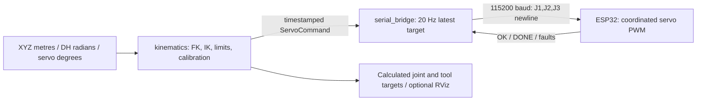

# Dum-E Robotic Arm v0 — ROS 2 Jazzy

ROS 2 control for the repository's calibrated three-joint arm and classic
ESP32/WROOM receiver. This checkout retains the Windows controller, CAD and
firmware and adds a native Ubuntu ROS 2 workspace.

Start with [ROS2_GUIDE.md](ROS2_GUIDE.md) for operation, topics, calibration,
serial permissions, firmware details and verification.

For the full explanation, read [Architecture and Testing](ARCHITECTURE_AND_TESTING.md):
ROS concepts/data flow, GUI controls, a file-by-file reference, launch commands,
staged real-arm tests, diagnostics, and recovery procedures.

## Original GUI, now through ROS 2

```bash
cd "$HOME/Desktop/Dum-E Robotic Arm v0"
./gui.sh
```

You can also open **Dum-E Arm Console (ROS 2)** from the application menu.

This opens the same Arm Console layout: Jog/FK/IK, joint/XYZ sliders, command and
mapping previews, pause, serial controls, and the mixed-pose Loop page. The
launcher starts both ROS control nodes as well. Closing the GUI stops them.
Offline edits are previews; selecting a port and pressing **Connect & stream**
starts control through the ROS serial bridge. Choose **ROS 2 dry run (no hardware)**
to test the interface without serial output, or select `/dev/ttyUSB0` for the
connected ESP32. Opening real serial may reset the board and command home.

The GUI delegates calculations to the kinematics node and never opens serial
itself. The original Windows files remain unchanged under `Code/arm_interface`;
use `gui.sh` for the ROS-backed interface.

## Quick start: no hardware required

In a terminal:

```bash
cd "$HOME/Desktop/Dum-E Robotic Arm v0"
./build_ros2.sh           # Already built on this computer; rerun after source edits
./run_ros2.sh            # Dry run; serial starts disabled
```

In a second terminal:

```bash
cd "$HOME/Desktop/Dum-E Robotic Arm v0"
./arm.sh servo 70 30 40  # Explicit target in servo degrees
./arm.sh enable         # Dry run: publishes frames without opening a serial port
./arm.sh status
./arm.sh xyz 0.1291673 0.0469705 0.2119948  # Metres; position IK
./arm.sh loop ros2_ws/src/dum_e_control/config/poses.yaml --cycles 1
./arm.sh disable
```

For the calculated target model in RViz, use `./run_ros2.sh visualize:=true`.
Send a target before expecting the robot model's moving transforms to appear.
This view shows commanded poses, not encoder feedback or a physics simulation.

## Hardware

Use the existing `Code/esp32_arm_receiver` firmware and its wiring instructions.
It already implements the ROS bridge's integer ASCII protocol.
Stop the dry-run launch with Ctrl+C, then select the actual serial device:

```bash
python3 -m serial.tools.list_ports -v
./run_ros2.sh dry_run:=false port:=/dev/serial/by-id/YOUR_ESP32_DEVICE
```

For the CP2102 ESP32 connected during setup, `./run_hardware.sh` supplies its
stable device path. It starts the same two nodes with serial still disabled.
The real board passed a home-only ROS communication test (61 frames sent,
60 matching ACKs and DONE replies); its firmware was not changed or flashed.

In another terminal, select the intended command and enable:

```bash
./arm.sh home
./arm.sh enable
./arm.sh status
./arm.sh servo 70 30 40
./arm.sh disable
```

**Opening the ESP32 serial port can reset it and move the arm to
`90,45,180` immediately.** Its existing firmware also homes at power-up.
The bridge waits 2.5 seconds before transmitting targets. Disable stops the
heartbeat; the firmware freezes its current PWM setpoints after its one-second
link timeout. This is not an immediate physical emergency stop.

## Two core ROS nodes



The command client exits after sending a request. The optional GUI, loop client
and RViz use the two control nodes above; GUI mode adds a ROS client process.

Original project documentation is in [MASTER_DOCUMENTATION.md](MASTER_DOCUMENTATION.md).
The new ROS 2 code is in `ros2_ws/src`; the original source is unchanged.
